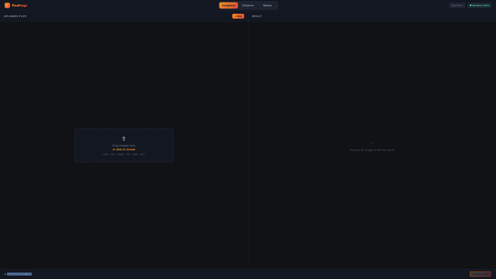

# PixelForge

A local, offline image processing app. Drop in images, choose what you want to do — compress, AI-upscale, or resize — and download the results. No cloud, no account, no file size limits.
<p align="center">
  
</p>

## Features

### Compress
Reduce file size while preserving visual quality.

- **JPEG** — uses [mozjpeg](https://github.com/mozilla/mozjpeg) when installed (better compression than libjpeg), falls back to Pillow
- **PNG** — uses [pngquant](https://pngquant.org/) for lossy palette quantization when installed, falls back to lossless Pillow compression
- **WebP** — Pillow with `method=6` (slowest / best)
- Quality slider (1–100), output format selector (original / JPEG / WebP / PNG), optional EXIF preservation
- Shows exact byte savings and percentage per file

### Enhance (AI Upscaling)
Restore sharpness and increase resolution using [Real-ESRGAN](https://github.com/xinntao/Real-ESRGAN).

- **×2** — `RealESRGAN_x2plus` model (~65 MB)
- **×4** — `RealESRGAN_x4plus` model (~65 MB)
- GPU-accelerated when CUDA is available, otherwise runs on CPU
- Handles images with transparency (alpha channel preserved)
- Output format: JPEG, WebP, or PNG

### Resize
Scale images to exact pixel dimensions or by a proportional factor.

- **Dimensions mode** — set target width × height, with optional aspect-ratio lock
- **Scale mode** — percentage-based downscale (10 % – 90 %)
- LANCZOS resampling for high-quality results
- Output format inferred from the original file

### General
- Drag-and-drop or click-to-browse upload (multi-file)
- Per-file progress via Server-Sent Events
- Download individual results or the whole batch as a ZIP
- Separate file queues per mode — switching tabs doesn't discard your uploads
- "Process" button re-unlocks automatically when settings change after a completed run
- Backend health indicator in the navbar

---

## Tech Stack

| Layer    | Technology |
|----------|------------|
| Frontend | React 19, TypeScript, Vite 8, Tailwind CSS 4 |
| Backend  | FastAPI, Uvicorn, Python 3.13 |
| AI model | Real-ESRGAN (PyTorch) via [basicsr](https://github.com/XPixelGroup/BasicSR) |
| Image ops | Pillow, pillow-heif |
| Optional | mozjpeg (`cjpeg`), pngquant |

---

## Requirements

- **Python 3.13**
- **Node.js 18+** (for the frontend)
- **git** (the setup script clones basicsr from source to patch a Python 3.13 incompatibility)
- `curl` (used to download model weights)
- Optional but recommended: **mozjpeg** and **pngquant** for better JPEG/PNG compression

Install optional tools on macOS:
```bash
brew install mozjpeg pngquant
```

---

## Installation

```bash
git clone https://github.com/giova86/PixelForge.git
cd PixelForge
./setup.sh
```

`setup.sh` does the following automatically:

1. Creates a Python virtual environment at `.venv/`
2. Installs Python backend dependencies
3. Installs PyTorch (CPU build if no CUDA)
4. Clones and patches basicsr for Python 3.13 compatibility, then installs Real-ESRGAN
5. Downloads the two Real-ESRGAN model weights (~65 MB each) into `backend/weights/`
6. Installs frontend npm dependencies

> **Note:** The first run takes several minutes because of PyTorch and the model downloads.

---

## Usage

```bash
./start.sh
```

This starts both processes and prints their URLs:

| Service  | URL |
|----------|-----|
| Frontend | http://localhost:5173 |
| Backend  | http://localhost:8000 |

Open http://localhost:5173 in your browser. Press `Ctrl+C` to stop everything.

---

## macOS app

PixelForge can be packaged as a standalone native Mac app (`PixelForge.app`). It opens in its own window, with native file pickers and "Save as" dialogs. Python, PyTorch, the backend, the compiled frontend and the model weights are all bundled inside, so the people who use it need nothing installed: no Python, no Node, no project folder.

### Build it

After running `./setup.sh` once (the build copies the packages from `.venv/` and the weights from `backend/weights/`):

```bash
./mac-app/build.sh          # creates PixelForge.app
./mac-app/build.sh --dmg    # also creates PixelForge.dmg (drag-to-Applications installer)
```

Build requirements: Apple Silicon Mac, Xcode Command Line Tools (`swiftc`), Node.js, and [uv](https://docs.astral.sh/uv/) (`brew install uv`, used to fetch a relocatable Python 3.13). The script compiles the Swift launcher, builds the frontend, bundles everything and ad-hoc signs the result.

The app is ~1.1 GB (`.dmg` ~580 MB), almost all of it PyTorch.

### Install on another Mac

Open `PixelForge.dmg` and drag PixelForge to Applications. The app is **not notarized** (no Apple Developer account), so on the first launch macOS shows an "unverified developer" warning: right-click the app → **Open** → **Open**. This is needed only once.

**Apple Silicon (M1 or later) only.** There is no Intel build.

### How it works

On launch, the Swift launcher ([mac-app/PixelForge.swift](mac-app/PixelForge.swift)) starts the bundled FastAPI backend on a free local port, waits for it to respond, then loads the UI in a `WKWebView`. The backend serves the compiled frontend itself, so a single process is enough. The backend stops when the app quits.

### App icon

[mac-app/AppIcon.icns](mac-app/AppIcon.icns) is picked up automatically by the build. To change the design, edit and re-run [mac-app/make-icon.py](mac-app/make-icon.py) (needs Pillow, e.g. `.venv/bin/python mac-app/make-icon.py`), or just replace the `.icns` file with your own.

---

## Running tests

```bash
cd backend
../.venv/bin/python -m pytest tests/ -v
```

The enhance tests load the Real-ESRGAN models and are slow (~30 s on CPU). Skip them with:

```bash
../.venv/bin/python -m pytest tests/ -v --ignore=tests/test_enhance.py
```

---

## Supported input formats

| Format | Compress | Enhance | Resize |
|--------|----------|---------|--------|
| JPEG   | ✓ | ✓ | ✓ |
| PNG    | ✓ | ✓ | ✓ |
| WebP   | ✓ | ✓ | ✓ |
| HEIC   | ✓ | ✓ | ✓ |
| TIFF   | ✓ | ✓ | ✓ |
| BMP    | ✓ | ✓ | ✓ |

---

## Project structure

```
pixelforge/
├── backend/
│   ├── main.py               # FastAPI app entry point
│   ├── routers/
│   │   ├── process.py        # /process, /resize, /stream, /result endpoints
│   │   └── download.py       # /download endpoints (single file, batch ZIP)
│   ├── services/
│   │   ├── compress.py       # JPEG/WebP/PNG compression logic
│   │   ├── enhance.py        # Real-ESRGAN upscaling
│   │   └── resize.py         # Pillow resize
│   ├── models/schemas.py     # Pydantic schemas
│   ├── tests/                # pytest test suite
│   ├── weights/              # model weights (gitignored, downloaded by setup.sh)
│   └── requirements.txt
├── frontend/
│   ├── src/
│   │   ├── App.tsx
│   │   ├── components/       # React components
│   │   ├── hooks/            # useFileQueue, useProcessing, useResizeProcessing
│   │   └── types/
│   ├── package.json
│   └── vite.config.ts
├── mac-app/
│   ├── PixelForge.swift      # native macOS launcher (window + backend process)
│   ├── build.sh              # builds PixelForge.app / PixelForge.dmg
│   ├── make-icon.py          # generates AppIcon.icns
│   └── AppIcon.icns
├── setup.sh                  # one-shot installer
└── start.sh                  # dev server launcher
```

---

## License

Apache License 2.0 — see [LICENSE](LICENSE) for the full text.

This software is free to use, modify, and distribute, including for commercial purposes.
**Attribution is required:** any distribution or derivative work must retain the
[NOTICE](NOTICE) file (or its contents) crediting the original author, Giovanni Bocchi.
